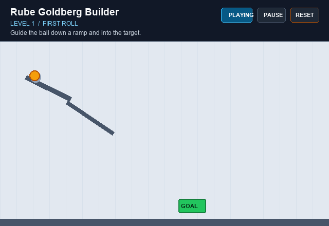

# Rube Goldberg Builder

A browser-based physics puzzle: arrange ramps, dominoes, and seesaws to guide a ball into the target.

[Play the game](https://shnxz-00.github.io/RuGoBu/)



## How to play

1. Read the goal and remaining part counts for the level.
2. Select a part, then click or drag on the board to place it. Drag placed parts to move them.
3. Select a part and press **R** to rotate it, or **Delete** to remove it.
4. Press **Play** to run the simulation. **Pause** freezes it; **Play** resumes.
5. Press **Edit** to stop the run and adjust the layout. **Reset** rebuilds the layout saved when the run started.
6. Get the ball into the green target to complete the level and earn stars based on parts used versus the level's par. If the ball leaves the board or the chain reaction stops, reset and try another layout.
7. On levels 4–6, press **L** in Edit mode to load that level's stored test solution.

The board adapts to the screen size. Touch gameplay is not currently supported.

## Features

- Six hand-built levels, each with a goal and limited part inventory.
- Edit, Play, Pause, and Reset modes, with win and stuck detection.
- Ramps, dominoes, and pivoted seesaws, plus fixed level obstacles and a target sensor.
- Earn 3 stars at or below par, 2 stars up to two parts over par, or 1 star otherwise. Best stars appear next to the level name and save in browser storage when available.
- Winning opens an accessible star-results dialog with parts-used/par, best score, Replay, and level navigation.
- Synthesized Web Audio effects respond to part placement, starting a run, and earned stars. The sound toggle remembers its state when browser storage is available.
- Pastel purple and steel-blue workshop interface with local fonts, icon-style part controls, and a blueprint board.
- Responsive 960 x 540 game world and locally vendored Matter.js.

## Physics concepts

- **Gravity and collisions:** Matter.js advances bodies through the level and resolves their contacts.
- **Friction and restitution:** part materials affect sliding, rolling, and bouncing.
- **Torque and pivot constraint:** the seesaw rotates around a Matter.js constraint at its center.
- **Fixed timestep:** the game advances physics in 1/60-second steps, independent of display refresh rate.
- **Data-driven reset:** level and player layouts are plain data, separate from Matter.js bodies. Reset rebuilds bodies from the layout saved at the start of the run rather than rewinding live physics objects.

## Project structure

```text
index.html                 Page structure and game canvas
style.css                  Responsive layout and controls
vendor/matter.min.js       Local Matter.js 0.20.0 build
assets/fonts/              Self-hosted Fredoka and Nunito Sans fonts and OFL licenses
assets/sounds/             Local WAV overrides for synthesized effects
src/
  config.js                World dimensions and simulation thresholds
  editor.js                Placement, selection, inventory, and modes
  levels.js                Level definitions and initial layouts
  main.js                  Rendering, game loop, and level flow
  parts.js                 Physics part factories
  physics.js               Matter.js world and collision helpers
  sound.js                 Synthesized effects, optional local audio, and mute state
docs/
  demo.gif                 Gameplay preview
  MVP.md                   Original milestone scope and checks
  PRD.md                   Product requirements
  V1_1_PLAN.md             Current improvement roadmap
```

## Run locally

The game uses browser ES modules, so serve the project over HTTP instead of opening `index.html` directly. From the project root, run:

```sh
python -m http.server 8000
```

Then open [http://localhost:8000/](http://localhost:8000/). The physics engine is included in `vendor/`; no package installation or CDN connection is needed to run the game.

The interface uses Fredoka and Nunito Sans, both distributed under the SIL Open Font License. Their local WOFF2 files and license texts are in `assets/fonts/`.

Sound effects are synthesized locally with the Web Audio API and do not require external services. Small locally generated WAV versions of those cues are included in `assets/sounds/` and automatically override synthesis after loading. Replace a same-named WAV file there to customize a cue; any added audio must be CC0 or otherwise properly licensed, with its source and license listed here.

## Roadmap

The v1.1 plan includes six levels, stored test solutions for levels 4–6, and best-star records. Slow-motion replay and touch controls are not currently in scope.

## Deployment

GitHub Actions publishes the static game to GitHub Pages when changes are pushed to `main`. For the initial setup, select **Settings > Pages > Build and deployment > Source > GitHub Actions**. The workflow publishes `index.html`, `style.css`, `src/`, `assets/`, and `vendor/`.
